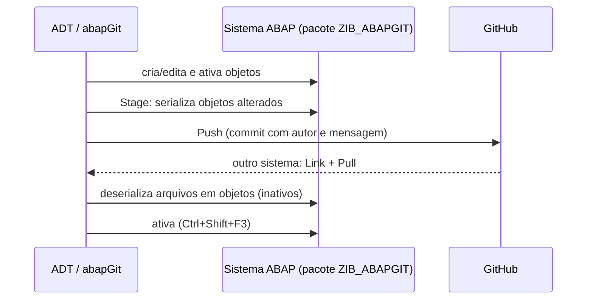

# abapGit - Study

> Nível: prática
> Git para código que vive no servidor ABAP: vínculo pacote ↔ repositório, *push*, *pull* e o
> formato de serialização, explicado com os próprios arquivos deste repositório. Relacionados:
> [ABAP-Development-Tools-devops-study](https://github.com/igor-barral/ABAP-Development-Tools-devops-study),
> [SAP-BTP-ABAP-Environment-devops-study](https://github.com/igor-barral/SAP-BTP-ABAP-Environment-devops-study),
> [SAP-gCTS-devops-study](https://github.com/igor-barral/SAP-gCTS-devops-study).

## Objetivo

No ABAP o código-fonte não é um arquivo no disco: é um objeto no repositório do sistema SAP. O
**abapGit** é um cliente Git open source, escrito em ABAP, que **serializa** os objetos de um pacote
em arquivos (`.abap` e `.xml`) e os envia para um repositório Git, e faz o caminho inverso
(**deserializa** arquivos em objetos). É assim que todos os repositórios deste roadmap vão para o
GitHub, e é a mesma estrutura que o abaplint lê no Docker.

Ao concluir este estudo você deverá ser capaz de responder perguntas como:

- Como versionar ABAP se o código vive no servidor?
- Como o abapGit transforma uma classe em arquivos, e o que cada arquivo contém?
- O que o `.abapgit.xml` controla?
- Como pacotes e subpacotes viram pastas?
- O que acontece com objetos que dependem de outros pacotes?
- Por que o abapGit não substitui o sistema de transporte?

## Ponte

| O que eu já conheço | No abapGit |
|---|---|
| `git clone` de um projeto | *Link/Clone* de um repositório a um **pacote** ABAP |
| `git push` | *Stage* + *Push*: serializa os objetos alterados e faz commit |
| `git pull` | *Pull*: deserializa os arquivos e cria/atualiza os objetos, que ficam **inativos** até ativar |
| `composer.json` / `package.json` com dependências | APACK (`ZIF_APACK_MANIFEST`) ou simplesmente documentar os repositórios que devem ser instalados antes |
| Migrations/ORM gerando o schema | Tabelas DDIC serializadas como XML (`.tabl.xml`) e recriadas pelo abapGit |
| Deploy por pipeline (CI/CD) | No SAP, o deploy entre sistemas é o **transporte** (CTS), não o Git |

## Conteúdo

### 1. Onde o abapGit roda

| Cenário | Backend (servidor) | Frontend |
|---|---|---|
| On-premise (ECC, S/4HANA) | Report `ZABAPGIT` instalado no sistema (versão *standalone* de https://abapgit.org), ou a versão *developer* | SAP GUI (HTML) ou plugin ADT, conforme a versão |
| BTP ABAP Environment e S/4HANA Cloud | Fornecido pela SAP no sistema | Plugin **abapGit Repositories** para ADT |

No BTP, instala-se o plugin ADT pelo site de atualização indicado na documentação do abapGit
(https://abapgit.org, seção de instalação do plugin ADT). Depois, a view *abapGit Repositories*
aparece em *Window > Show View*.

### 2. Fluxo básico



1. **Link**: *Link New abapGit Repository*, informar URL do GitHub, pacote de destino e, se for
   privado, usuário e token.
2. **Pull**: o abapGit cria os objetos no pacote. Objetos criados ficam inativos até a ativação.
3. **Stage e Push**: após alterar e ativar, *Stage and Push* mostra o diff por objeto e arquivo;
   escolher os arquivos, informar a mensagem e enviar.
4. **Diff**: antes do *pull*, o abapGit mostra o que muda no sistema; antes do *push*, o que muda no
   repositório.

Repositórios **online** falam direto com o servidor Git; **offline** trabalham com arquivo ZIP
(útil quando o sistema não tem acesso à internet).

### 3. A serialização, arquivo por arquivo

Árvore deste repositório:

```
.abapgit.xml                                     configuração do repositório
src/package.devc.xml                             pacote ZIB_ABAPGIT
src/zif_ib_abapgit_greeter.intf.abap             interface: código
src/zif_ib_abapgit_greeter.intf.xml              interface: metadados
src/zcl_ib_abapgit_demo.clas.abap                classe: definição + implementação
src/zcl_ib_abapgit_demo.clas.locals_imp.abap     classe: classes locais (include "Local Types")
src/zcl_ib_abapgit_demo.clas.testclasses.abap    classe: classes de teste ABAP Unit
src/zcl_ib_abapgit_demo.clas.xml                 classe: metadados
src/util/package.devc.xml                        subpacote ZIB_ABAPGIT_UTIL
src/util/zcl_ib_abapgit_text_util.clas.abap      classe do subpacote
src/util/zcl_ib_abapgit_text_util.clas.xml
```

**Regra de nome**: `<nome do objeto em minúsculas>.<tipo do objeto>.<parte>.<extensão>`. O tipo é
o código do objeto no repositório SAP: `clas` (classe), `intf` (interface), `devc` (pacote), `tabl`
(tabela), `ddls` (CDS), `bdef` (behavior definition), `prog` (programa), `fugr` (grupo de funções).
Objetos com namespace (`/ABC/CL_X`) trocam `/` por `#` no nome do arquivo (`#abc#cl_x.clas.abap`).

**Código e metadados separados**: o que é código vai em `.abap` (ou `.asddls`, `.asbdef` para CDS
e BDEF); o que é propriedade do objeto vai no `.xml`. Veja
[`src/zcl_ib_abapgit_demo.clas.xml`](src/zcl_ib_abapgit_demo.clas.xml):

```xml
<abapGit version="v1.0.0" serializer="LCL_OBJECT_CLAS" serializer_version="v1.0.0">
 <asx:abap xmlns:asx="http://www.sap.com/abapxml" version="1.0">
  <asx:values>
   <VSEOCLASS>
    <CLSNAME>ZCL_IB_ABAPGIT_DEMO</CLSNAME>
    <LANGU>E</LANGU>
    <DESCRIPT>abapGit serialization demo</DESCRIPT>
    <STATE>1</STATE>
    <CLSCCINCL>X</CLSCCINCL>
    <FIXPT>X</FIXPT>
    <UNICODE>X</UNICODE>
    <WITH_UNIT_TESTS>X</WITH_UNIT_TESTS>
   </VSEOCLASS>
  </asx:values>
 </asx:abap>
</abapGit>
```

- `serializer="LCL_OBJECT_CLAS"`: a classe interna do abapGit que sabe ler e gravar esse tipo.
- `asx:abap` / `asx:values`: formato XML padrão de serialização do ABAP (transformação ID).
- `VSEOCLASS`: a estrutura do dicionário SAP com os atributos da classe. `DESCRIPT` é a descrição
  curta, `LANGU` o idioma original, `FIXPT` a aritmética de ponto fixo, `WITH_UNIT_TESTS` indica que
  existe o include de testes.

**Uma classe, vários arquivos**: a classe global tem includes separados no sistema, e cada um vira um
arquivo:

| Include no ADT (abas na parte de baixo do editor) | Arquivo |
|---|---|
| *Global Class* | `.clas.abap` |
| *Local Types* (implementações locais) | `.clas.locals_imp.abap` |
| *Class-relevant Local Types* (definições locais) | `.clas.locals_def.abap` |
| *Test Classes* | `.clas.testclasses.abap` |
| *Macros* | `.clas.macros.abap` |

Aqui, `lcl_banner` está em
[`zcl_ib_abapgit_demo.clas.locals_imp.abap`](src/zcl_ib_abapgit_demo.clas.locals_imp.abap) e é
usada pelo `main` da classe global; o teste `ltc_greeter` está em
[`zcl_ib_abapgit_demo.clas.testclasses.abap`](src/zcl_ib_abapgit_demo.clas.testclasses.abap).

**Interface**: [`zif_ib_abapgit_greeter.intf.xml`](src/zif_ib_abapgit_greeter.intf.xml) usa a
estrutura `VSEOINTERF` (`EXPOSURE` 2 = pública).

**Pacote**: [`src/package.devc.xml`](src/package.devc.xml) guarda só a descrição (`CTEXT`). O nome
do pacote **não** está no arquivo: ele vem do vínculo feito no *Link* (raiz) e da pasta
(subpacotes).

### 4. O `.abapgit.xml`

```xml
<DATA>
 <MASTER_LANGUAGE>E</MASTER_LANGUAGE>
 <STARTING_FOLDER>/src/</STARTING_FOLDER>
 <FOLDER_LOGIC>PREFIX</FOLDER_LOGIC>
 <IGNORE>
  <item>/.gitignore</item>
  <item>/README.md</item>
  <item>/abaplint.json</item>
  ...
 </IGNORE>
</DATA>
```

| Campo | O que controla |
|---|---|
| `MASTER_LANGUAGE` | Idioma original dos objetos (aqui `E`, inglês, o recomendado para textos técnicos). |
| `STARTING_FOLDER` | Pasta onde começam os objetos. Tudo fora dela (README, Docker) não é ABAP. |
| `FOLDER_LOGIC` | Como subpacotes viram pastas: `PREFIX` (padrão) ou `FULL` (versões recentes do abapGit têm outras variantes; confirme na documentação). |
| `IGNORE` | Arquivos que o abapGit não deve tentar deserializar. |

Outros campos existem (requisitos de versão de componente, idiomas de tradução, versão de
linguagem ABAP); consulte a documentação do abapGit antes de usá-los.

### 5. Subpacotes e `FOLDER_LOGIC`

Com `PREFIX`, o nome do subpacote precisa começar com o nome do pacote pai seguido de `_`, e a pasta
é o restante:

```
ZIB_ABAPGIT        -> src/
ZIB_ABAPGIT_UTIL   -> src/util/
```

Por isso [`src/util/zcl_ib_abapgit_text_util.clas.abap`](src/util/zcl_ib_abapgit_text_util.clas.abap)
pertence a `ZIB_ABAPGIT_UTIL`. Com `FULL`, a pasta teria o nome completo do subpacote
(`src/zib_abapgit_util/`) e não haveria exigência de prefixo.

### 6. Dependências entre pacotes

O abapGit serializa **somente o pacote vinculado e seus subpacotes**. Se `ZCL_IB_ABAPGIT_DEMO`
usasse uma classe de outro pacote Z, esse outro pacote precisaria:

1. já existir no sistema de destino, ou
2. ser instalado antes, a partir do seu próprio repositório.

Sem isso, o *pull* cria o objeto mas a ativação falha por objeto desconhecido. Objetos SAP padrão
(como `IF_OO_ADT_CLASSRUN` e `CL_ABAP_UNIT_ASSERT`) já existem em qualquer sistema e não são
problema, desde que liberados para a versão de linguagem usada.

Formas de lidar com isso:

- **APACK**: o repositório declara dependências implementando `ZIF_APACK_MANIFEST` (ou a interface
  equivalente do sistema); o abapGit pode listar e instalar as dependências.
- **Documentar no README** a ordem de instalação (o caso deste roadmap, onde cada repositório é
  independente).
- No **abaplint**, as dependências externas são declaradas em `abaplint.json` (`dependencies`). É
  por isso que [`abaplint.json`](abaplint.json) aponta para https://github.com/abaplint/deps: são
  *stubs* de objetos SAP para o linter reconhecer as interfaces padrão.

### 7. abapGit não é transporte

| Ponto | abapGit | Sistema de transporte (CTS) |
|---|---|---|
| Objetivo | Versionar, compartilhar e revisar código | Levar alterações de DEV para QAS e PRD com controle |
| Unidade | Repositório Git ligado a um pacote | Ordem de transporte com tarefas por usuário |
| Histórico | Commits, branches, pull requests | Log de transportes e versões de objeto no sistema |
| Governança em cliente | Complementar | Oficial, auditado, exigido pelo processo de mudança |

Em on-premise, fazer *pull* num pacote transportável grava os objetos numa ordem de transporte, e é
essa ordem que segue para os próximos sistemas. O abapGit entra como fonte de verdade do código e
ferramenta de revisão; a promoção entre ambientes continua pelo CTS (ou gCTS, ver
[SAP-gCTS-devops-study](https://github.com/igor-barral/SAP-gCTS-devops-study)). No BTP ABAP Environment, o transporte entre
sistemas usa componentes de software geridos pela SAP, também separado do abapGit.

## Respostas

**Como versionar ABAP se o código vive no servidor?**
Com um cliente Git que roda no próprio sistema: o abapGit serializa os objetos do pacote em arquivos
e os envia para o Git, e deserializa no caminho inverso. O Git passa a ser a fonte de verdade; o
sistema trial pode ser recriado a partir dele.

**Como o abapGit transforma uma classe em arquivos?**
Código em `.clas.abap` (e um arquivo por include: `locals_imp`, `locals_def`, `testclasses`,
`macros`) e metadados em `.clas.xml` com a estrutura `VSEOCLASS`. O nome do arquivo segue
`nome.tipo.parte.extensão`.

**O que o `.abapgit.xml` controla?**
Idioma original, pasta inicial, lógica de pastas para subpacotes e arquivos ignorados, entre outras
opções.

**Como pacotes e subpacotes viram pastas?**
O pacote raiz corresponde à `STARTING_FOLDER`. Com `PREFIX`, cada subpacote vira uma pasta com o
nome sem o prefixo do pai; com `FULL`, a pasta tem o nome completo.

**O que acontece com objetos que dependem de outros pacotes?**
O abapGit não leva as dependências junto. Elas precisam existir no destino ou ser instaladas antes
(APACK ou instrução no README); caso contrário a ativação falha.

**Por que o abapGit não substitui o sistema de transporte?**
Porque o transporte é o mecanismo oficial, auditado e integrado ao processo de mudança para mover
alterações entre DEV, QAS e PRD. O abapGit versiona e compartilha código, mas não controla a
promoção entre sistemas do cliente.

## Como rodar

### Verificação local (sem sistema SAP)

```bash
docker compose run --rm abaplint
```

Resultado esperado: `abaplint: 0 issue(s) found`, com os 10 arquivos de `src/` analisados (incluindo
o subpacote).

### Execução real

1. BTP ABAP Environment trial com o plugin abapGit no ADT (ou `ZABAPGIT` num ABAP Platform Trial).
2. Criar o pacote `ZIB_ABAPGIT` (e, se o sistema não criar automaticamente, o subpacote
   `ZIB_ABAPGIT_UTIL` com `ZIB_ABAPGIT` como superpacote).
3. *Link New abapGit Repository* com a URL deste repositório e o pacote `ZIB_ABAPGIT`; *Pull*.
4. Ativar tudo (Ctrl+Shift+F3), rodar `ZCL_IB_ABAPGIT_DEMO` com F9 e os testes com Ctrl+Shift+F10.
5. Exercício: alterar a descrição da classe no ADT, fazer *Stage* e observar que só o `.clas.xml`
   muda no diff; depois alterar o código e ver o `.clas.abap` mudar.

## Referências

- abapGit, documentação e instalação: https://abapgit.org e https://docs.abapgit.org
- Código-fonte do abapGit: https://github.com/abapGit/abapGit
- SAP Help Portal, abapGit no BTP ABAP Environment: https://help.sap.com (buscar "abapGit
  Repositories ABAP Environment").
- SAP Developer tutorials: https://developers.sap.com (buscar "abapGit").
- abaplint e dependências: https://abaplint.org e https://github.com/abaplint/deps
